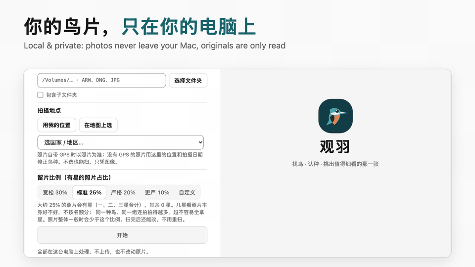

# 观羽 · BirdCM

**本地、私密的鸟类摄影助手。** 照片不离开你的设备。

A local, private assistant for bird photographers. Your photos never leave your device.



## 能做什么

**Mac 版**（网页界面，在本机运行）：一次拍了上千张 RAW，帮你筛片。

- 找鸟、认种（全球 11,000+ 种，按拍摄地点和季节修正），看眼睛和嘴是否清晰、是不是在飞、头部锐度，打星
- 连拍取一致结果；当地稀有度与 IUCN（数据表暂未发布，见下方许可）
- 鸟种清单、统计、日历、地图；导出 CSV / JSON 和 [eBird 文件](docs/ebird.md)
- 照片文件夹只读，不改、不上传

**iPhone 版**（iOS 17+）：单张照片离线识别。

- 拍照或从相册选图，识别鸟种并给出当地稀有度
- 记录、鸟种、统计、探索；维基百科简介与参考图（可在设置里关掉）

名称统一两行显示：中文名在上，英文名 · *学名* 在下。

## 下载

[GitHub Releases](https://github.com/lincleejun/BirdCM/releases)：

- **Mac**：`GuanYu-<版本>-arm64.dmg`，需要 Apple Silicon 和 macOS 15 或更高版本。安装包没有经过 Apple 公证，第一次打开的方法见发布说明。模型在第一次使用时下载，约 0.8 GB。
- **iPhone**：`GuanYu-<版本>-iOS-unsigned.ipa`，没有签名，要用 AltStore 或 Sideloadly 以你自己的 Apple ID 签名后安装。模型已经打包在里面。

## 从源码运行（Mac）

需要 macOS、[uv](https://docs.astral.sh/uv/)、Node 20+ 和 `exiftool`（`brew install exiftool`）。

```sh
cd web && npm install && npm run build && cd ..
cd engine
uv run birdcm models fetch   # 下载并校验模型
uv run birdcm serve          # http://127.0.0.1:8765/
uv run pytest
```

iOS 的构建与测试见 [ios/README.md](ios/README.md)；如何发版见 [docs/release.md](docs/release.md)。设计文档在 [docs/design.md](docs/design.md)。

## 联网

只有下面三种情况会联网，都可以关掉：

- 打开地图时加载 OpenStreetMap 图块
- 用 Nominatim 显示地名，只发送取整到约 1 km 的坐标
- 物种页的维基百科资料，只发送物种的条目名

照片、路径和你输入的文字从不上传。

## 许可

代码使用 MIT 许可。模型和数据各有自己的许可，见 [NOTICE.md](NOTICE.md)：

- 眼/喙模型头和飞行模型头**仅限非商业用途**。
- 清晰度门槛、美学模型头和稀有度表的数据许可还在确认，暂未发布。
