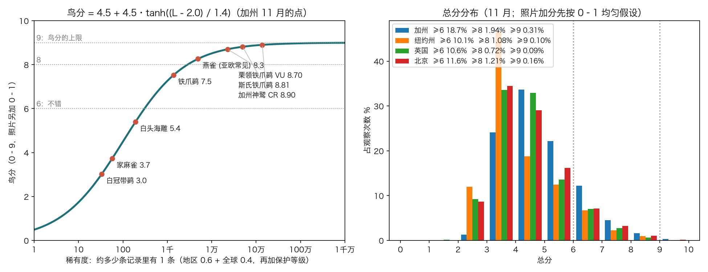

# 鸟价值分（设计稿第四版，2026-11-19，未实现）

> **已被 `docs/bird-value.md`（主人的设计）取代**，保留作历史记录。

**一张照片只有一个分，0.00–10.00，两位小数。** 算出来以后就存下来，不会因为再算一次、换一批照片、在 Mac 和手机之间切换而改变。

第四版（同日）：稀有度改为地区和全球加权合成；曲线放宽到大部分观察落在 3–6 分，6 分以上约一成，9 分以上千里挑一到三。第三版：改用 tanh 曲线，因为第二版的分段折线太严，一半照片在 3 分以下。第一版被主人否了，原因有两个：同一种鸟会有两个分（没拍到和拍到时不一样），同一张照片前后几次算出来差很多。这一版改为：

> **分 = 鸟分（0–9.00，这种鸟在这里、这个月有多难见，保护等级多高）+ 照片加分（0–1.00，拍得好适当加一点）**，总分最多 10。

"是不是生涯新种"不进分数，它本来就会随时间变化。新种照旧显示新种标记。

## 1. 依据

- **BirdDex** 的做法是每张照片的分 = 稀有度 × 保护等级。[^birddex] 我们沿用"稀有度 + 保护等级"这个骨架。照片加分是另加的一小项。
- **Birda** 的稀有度按地点算，数据来自 GBIF。[^birda] 我们的 GBIF 稀有度表（`rarity-global.sqlite`）有每个地区、每个月每种鸟的记录数，可以算出连续的**记录占比**，比 Birda 的 0–9 档位更细。
- **Macaulay Library** 的照片评级只看技术质量，不看稀有度。[^ml] 所以照片是独立的一项，而且只占小头。

## 2. 鸟分（0–9.00）

左图是曲线和加州 11 月几种鸟的位置。右图是四个地区的总分分布：按观察次数算，照片加分先假设在 0–1 之间均匀分布。

### 2.1 稀有度：地区和全球加权

稀有度从两个角度看，都用"多少条记录里才有一条是它"，取以 10 为底的对数：

- **地区 L_地区**：拍摄地所在的州或省，在拍摄月份的数据。没有州、省数据时用所在国家的数据。
- **全球 L_全球**：同一个月里，这种鸟在**最容易见到的地方**有多稀有。取所有国家、州、省里的最小值，只算记录数 ≥ 2,000、而且这种鸟至少有 5 条记录的地区。
  - 燕雀在加州是迷鸟，但在欧亚大陆很常见，所以全球分低。
  - 圣岛丛鸦只在加州的一个岛上有，最容易见的地方也稀少，所以全球分高。
  - 这里不用"全球总记录占比"：全球的 GBIF 记录大部分来自美国和英国，按总占比算，亚洲鸟会被算得偏稀有。

**L = 0.6 × L_地区 + 0.4 × L_全球 + 保护等级**

保护等级算作"更稀有"：

| IUCN 等级 | L 增加 | 相当于稀有了 |
|---|---|---|
| 近危 NT | +0.3 | 2 倍 |
| 易危 VU | +0.6 | 4 倍 |
| 濒危 EN | +1.0 | 10 倍 |
| 极危 CR | +1.5 | 30 倍 |

因为最容易见到的地方也包括拍摄地本身，全球稀有度不会高于地区稀有度。所以加了全球这一项，**在本地罕见、但在别处常见的鸟会降一些，但仍然高**。比如燕雀：地区 8.90，全球 2.96，合成后 8.26。

### 2.2 曲线

**鸟分 = 4.5 + 4.5 × tanh((L − 2.0) / 1.4)**

这条曲线中间陡、两头平，越稀有加得越慢，永远到不了 9。

| 鸟（加州 11 月） | 只看地区 | 只看全球 | **合成** |
|---|---|---|---|
| 白冠带鹀 | — | — | **3.01** |
| 家麻雀 | 5.08 | 1.99 | **3.72** |
| 白头海雕 | 7.03 | 2.59 | **5.39** |
| 铁爪鹀（Lapland Longspur，北极圈常见） | 8.29 | 5.35 | **7.52** |
| 燕雀（加州迷鸟，亚欧常见） | 8.90 | 2.96 | **8.26** |
| 圣岛丛鸦（岛屿特有） | — | — | **8.61** |
| 栗领铁爪鹀（VU） | 8.85 | 8.19 | **8.70** |
| 斯氏铁爪鹀（Smith's Longspur） | 8.96 | 7.56 | **8.81** |
| 加州神鹫（CR） | 8.93 | 8.82 | **8.90** |

"只看地区"和"只看全球"两列不进总分，只在详情里显示。比如"在加州 8.90，放到全球 2.96"，说明这只是本地少见。

### 2.3 分布

总分 = 鸟分 + 照片加分。照片加分先假设在 0–1 之间均匀分布，统计的是 11 月：

| 地区 | 6 分以上 | 8 分以上 | 9 分以上 |
|---|---|---|---|
| 加州 | 18.7% | 1.94% | 0.31% |
| 纽约州 | 10.1% | 1.08% | 0.10% |
| 英国 | 10.6% | 0.72% | 0.09% |
| 北京 | 11.6% | 1.21% | 0.16% |

整体感觉：
- 大部分观察在 3–6 分。
- 6 分以上大约十次里有一两次，算"不错"。
- 8 分以上大约百里挑一。
- 9 分以上大约千里挑一到挑三，算"很稀缺"。

加州高一些，是因为那里的鸟种多、迷鸟多。

我比较过的其他做法：
- 正态分布（按名次）：家麻雀会到 5 分左右，罕见鸟全挤在 9 分，不同地区没法比。
- 第二版的分段折线：太严。
- 只看地区：加州 6 分以上的有 25%，偏松。

比较用的脚本在 `engine/bench/bird_score/`：`distribution.py` 算分布，`plot.py` 出图。

### 2.4 细则

- **地点和月份用拍摄时的**，不用现在的位置。
- **数据缺失时**：照片没有地点，或者这个地区和月份没有数据时，退到所在国家同一个月的数据（稀有度表已经有这种退路，coverage 为 `country`）。连国家数据也没有，就**不打分**，显示"缺地点，无法评分"，不硬猜。
- **本地无记录的种，地区稀有度按只有 1 条记录算，但要核实**：鸟种没有确认（认种把握低，或者主人没确认）时，界面在分数后面写"待确认"。这样认错了的鸟不会白拿高分。
- **公开版没有 IUCN 数据**，保护等级不推高 L，这一项显示"—"，不写成"无危"。

## 3. 照片加分（0–1.00）

照片加分 = 1.00 × Q。Q（0–1）**只用不依赖这一批照片的绝对信号**。Mac 和手机都有这些信号，所以同一张照片在两边得分一样：

| 信号 | 权重 |
|---|---|
| 眼睛可见概率 | 0.35 |
| 鸟的大小（框面积占比，到 4% 算满） | 0.25 |
| 识别器判断"看得清" | 0.20 |
| 在飞 | 0.10 |
| 检测把握 | 0.10 |

缺的信号按 0.5 计算。

标星用的综合分 Q 不能拿来用：它里面的清晰度和美学是**在这一批、这一组连拍里排的百分位**，换一批照片就会变，正是"前后几次差异很大"的来源。

认不出鸟种的照片不打分。拍得一般也只是少加几分，不会扣到鸟分以下。

## 4. 例子（加州 11 月）

| 照片 | 鸟分 | 照片加分 | **总分** |
|---|---|---|---|
| 白冠带鹀，拍得一般 | 3.01 | 0.55 | **3.56** |
| 家麻雀，拍得很好 | 3.72 | 0.90 | **4.62** |
| 白头海雕，拍糊了 | 5.39 | 0.25 | **5.64** |
| 白头海雕，拍得很好 | 5.39 | 0.90 | **6.29** |
| 铁爪鹀，拍得一般 | 7.52 | 0.55 | **8.07** |
| 加州神鹫，拍糊了 | 8.90 | 0.25 | **9.15** |
| 斯氏铁爪鹀，拍得很好 | 8.81 | 0.85 | **9.66** |

## 5. 什么时候分会变

- **算一次就存下来**，同时记下用的是哪个版本的稀有度表。之后打开、重扫、换设备，都不会再算一遍。
- **只在三种情况下重算**：主人改了鸟种、改了地点、改了拍摄时间。改了以后详情里写"已按新的鸟种重算"。
- **稀有度表更新后，旧照片的分不自动变**。设置里提供"按新数据重算全部"，由主人自己决定要不要重算。
- **一种鸟的分**：图鉴和探索列表里看不到照片，只显示"这里、这个月的鸟分"。这就是拍到它时会拿到的底分，不会有第二个分。我拍过的种，显示我那张最高分的照片。

## 6. 界面

- 总分写成两位小数，比如 **8.17**。
- 点开后看到分数是怎么来的，比如"加州 11 月 · 在加州 8.93 · 放到全球 8.82 · IUCN 极危（按稀有 30 倍算）· 鸟分 8.90 · 照片 +0.85（眼睛清楚、在飞）"。
- 分只给自己看，不做排行榜。分越高的照片，分享时显示的地点越模糊。巢和雏鸟的照片不加分，免得为了分去打扰鸟。[^birdex]

## 7. 已知局限

- GBIF 的记录有偏差：观鸟的人会专门去追稀有鸟，所以稀有鸟的记录偏多，算出来的分偏保守。热门观鸟地和偏远地区的总记录数也差很多。L 用的是"占比"而不是绝对数，可以抵消一部分这种差异。
- 稀有度表是按州、省统计的，粒度比较粗。比如在加州，Cupertino 和沙漠地区算出来的稀有度一样。以后可以接入地点模型（`Geo.swift`）的出现概率来细化到具体地点。
- 节点和权重是第一版取值，只用公开的 GBIF 数据定，没有用主人的照片定任何参数。

## 8. 待主人定

1. 地区和全球的权重：现在地区 0.6、全球 0.4。想更看重全球稀缺，可以改成 0.5 / 0.5，本地迷鸟的分会再低一些。
2. 曲线松紧：现在中心 2.0、宽 1.4。中心改到 2.1、宽 1.6 会更严一点，6 分以上降到 8–15%。
3. 照片加分最多 1 分，够不够。

[^birddex]: [BirdDex on Product Hunt](https://www.producthunt.com/posts/birddex)；[HN Showcase](https://www.hnshowcase.com/post/47376539/birddex-pok-mon-go-but-with-real-life-birds)
[^birda]: [Rarity Scores on Birda](https://support.birda.org/en/articles/8340312-rarity-scores-on-birda)
[^ml]: [Macaulay Library photo rating examples](https://www.macaulaylibrary.org/photo-rating-examples/)
[^birdex]: [Birdex turns bird spotting into a game](https://www.onegreenplanet.org/news/birdwatching-app-birdex-turns-bird-spotting-into-a-game/)
